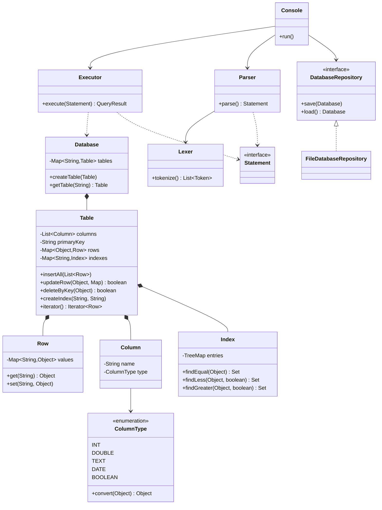
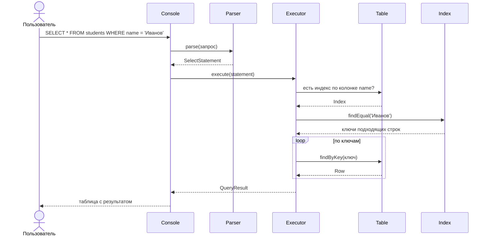

# Упрощённая СУБД

Лабораторная работа №2. Консольная база данных на Java: хранит таблицы в файле,
выполняет SQL-подобные запросы, поддерживает индексы.

Нейгум Софья

## Запуск

```
mvn compile
java -cp target/classes ru.dbms.cli.Main
```

База хранится в файле `db.dat`, загружается при запуске.
Тесты: `mvn test`. Замеры: `java -cp target/classes ru.dbms.benchmark.IndexBenchmark`.

## Команды

```sql
CREATE TABLE groups (id INT PRIMARY KEY, name TEXT, created DATE);
CREATE TABLE students (id INT PRIMARY KEY, name TEXT, scholarship DOUBLE,
                       birth_date DATE, is_budget BOOLEAN, group_id INT);

INSERT INTO groups VALUES (1, 'ИКБО-12-24', '2024-09-01');
INSERT INTO students VALUES (1, 'Нейгум Софья', 8000.0, '2006-03-15', TRUE, 1),
                            (2, 'Иванов Иван', 5000.0, '2005-07-20', TRUE, 1);
INSERT INTO students (id, name) VALUES (3, 'Петров Пётр');

SELECT * FROM students;
SELECT name, scholarship FROM students WHERE scholarship > 5000;

UPDATE students SET scholarship = 12000 WHERE id = 1;
DELETE FROM students WHERE is_budget = FALSE;

CREATE INDEX idx_students_name ON students (name);
DROP TABLE groups;
```

Типы колонок: `INT`, `DOUBLE`, `TEXT`, `DATE`, `BOOLEAN`.
Сравнения: `=`, `<>`, `!=`, `<`, `<=`, `>`, `>=`.
Значения: `42`, `8000.0`, `'текст'`, `'2026-03-15'`, `TRUE`, `FALSE`, `NULL`.
Команды консоли: `TABLES`, `HELP`, `EXIT`.

Вывод:

```
sql> SELECT id, name, scholarship FROM students;
+----+--------------+-------------+
| id | name         | scholarship |
+----+--------------+-------------+
| 1  | Нейгум Софья | 12000.0     |
| 2  | Иванов Иван  | 5000.0      |
| 3  | Петров Пётр  | NULL        |
+----+--------------+-------------+
Строк: 3
```

## Предметная область

Студенты и группы. Колонка `students.group_id` ссылается на `groups.id`.

## Из чего состоит

| Пакет | Отвечает за |
|---|---|
| `model` | таблицы, строки, колонки, типы данных |
| `index` | индексы по колонкам |
| `storage` | запись базы в файл и чтение |
| `sql` | разбор текста запроса |
| `exec` | выполнение запросов, вывод таблицей |
| `cli` | консоль |
| `benchmark` | замеры скорости |

Паттерны: **Repository** (`DatabaseRepository` + `FileDatabaseRepository`),
**Iterator** (`Table implements Iterable<Row>`), **Command** (класс на каждый вид запроса).



## Как выполняется запрос



## Хранение

База пишется в файл стандартной сериализацией Java после каждого изменяющего
запроса. Запись идёт во временный файл, который затем заменяет основной —
поэтому сбой во время сохранения не портит ранее сохранённые данные.
Индексы хранятся внутри таблиц и сохраняются вместе с базой.

## Индексы

Индекс хранит соответствие «значение колонки — ключи строк» в `TreeMap`.
Дерево выбрано вместо хеш-таблицы, чтобы работали не только `=`, но и `<`, `>`.
Обновляется автоматически при вставке, изменении и удалении строк.

Перед выполнением запроса с условием программа проверяет, есть ли индекс
по нужной колонке: если есть — берёт строки через него, иначе перебирает таблицу.
Для `<>` индекс не используется.

## Замеры

Две одинаковые таблицы по 100 000 строк, индекс построен только во второй.
Колонка `city` содержит 10 разных значений. По 20 прогревочных запусков
и 50 измеряемых, в таблице среднее.

Заполнение 200 000 строк — 501 мс, построение индекса — 42 мс.

| Запрос | Без индекса | С индексом | Выигрыш | Строк |
|---|---|---|---|---|
| `WHERE city = 'Москва'` | 10.188 мс | 1.808 мс | 5.6× | 9936 |
| `WHERE city = 'Калуга'` | 9.192 мс | 2.036 мс | 4.5× | 9977 |
| `WHERE city = 'Нет такого'` | 7.195 мс | 0.001 мс | 5377.6× | 0 |
| `WHERE city > 'Тверь'` | 8.832 мс | 2.593 мс | 3.4× | 10038 |
| `WHERE city <> 'Москва'` | 17.184 мс | 15.392 мс | 1.1× | 90064 |

## Тестирование

146 тестов на JUnit 5 (`mvn test`). Отдельно проверяется, что запросы
с индексом и без дают одинаковый результат.

## Выводы

Индекс ускоряет поиск по равенству в 4–5 раз, по диапазону — в 3.4 раза.
На условии `<>` выигрыша нет: под него подходит почти вся таблица.
Наибольший эффект — на запросах без результата, где индекс отвечает сразу,
а перебор проходит все строки.

Индекс занимает память и обновляется при каждом изменении данных,
поэтому создавать его стоит только для часто используемых колонок.

## Источники

1. Документация Java SE 17 — https://docs.oracle.com/en/java/javase/17/docs/api/
2. Сериализация в Java — https://docs.oracle.com/en/java/javase/17/docs/specs/serialization/
3. Руководство JUnit 5 — https://junit.org/junit5/docs/current/user-guide/
